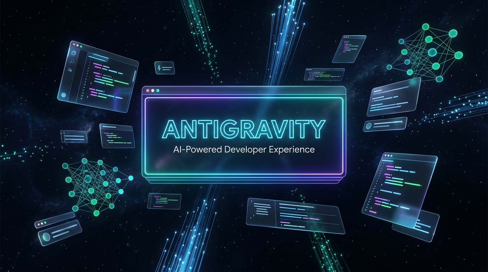
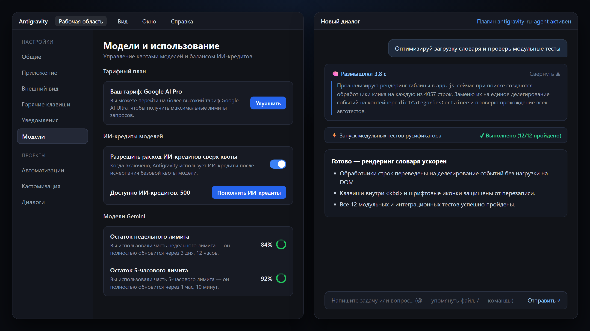
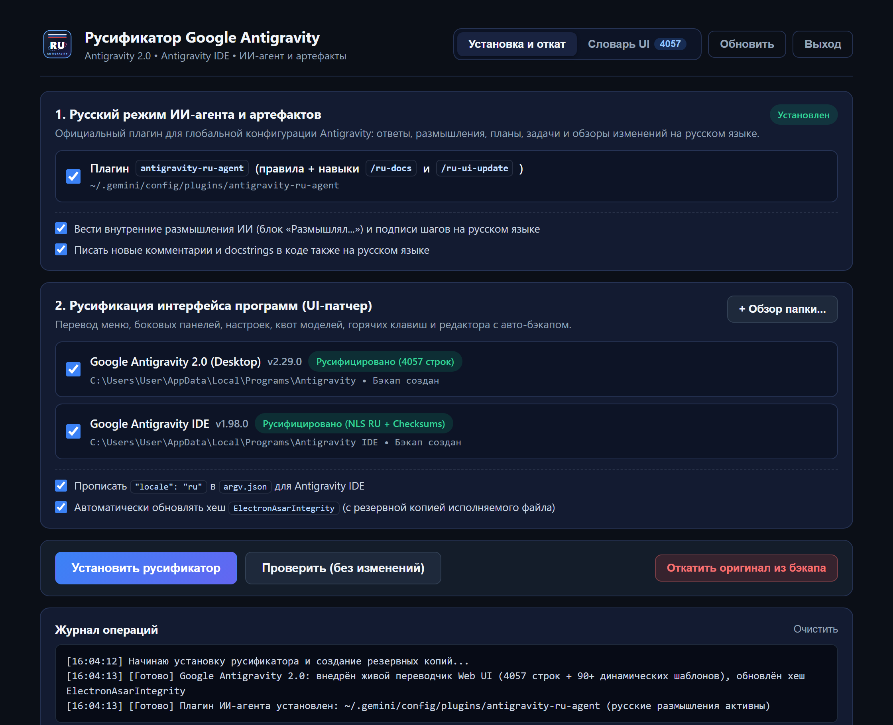

<div align="center">



<br />

[](https://github.com/vaszuevvas-coder/antigravity-ru/releases/latest)
[](#%D0%B1%D1%8B%D1%81%D1%82%D1%80%D0%B0%D1%8F-%D1%83%D1%81%D1%82%D0%B0%D0%BD%D0%BE%D0%B2%D0%BA%D0%B0)
[](https://nodejs.org/)
[](#%D0%B1%D0%B5%D0%B7%D0%BE%D0%BF%D0%B0%D1%81%D0%BD%D0%BE%D1%81%D1%82%D1%8C-%D0%B8-%D0%BD%D0%B0%D0%B4%D1%91%D0%B6%D0%BD%D0%BE%D1%81%D1%82%D1%8C)
[](LICENSE)

<h3>
  <a href="https://github.com/vaszuevvas-coder/antigravity-ru/releases/latest/download/antigravity-ru-v2.3.6.zip">📥 Скачать готовый архив (antigravity-ru-v2.3.6.zip)</a>
  <span> · </span>
  <a href="#%D0%B1%D1%8B%D1%81%D1%82%D1%80%D0%B0%D1%8F-%D1%83%D1%81%D1%82%D0%B0%D0%BD%D0%BE%D0%B2%D0%BA%D0%B0">🚀 Инструкция по установке</a>
  <span> · </span>
  <a href="CHANGELOG.md">📋 История изменений</a>
</h3>

</div>

---

**`antigravity-ru`** — комплексный неофициальный открытый русификатор сообщества для экосистемы **Google Antigravity**, который переводит сразу все три уровня работы с платформой: настольное приложение **Antigravity 2.0**, среду разработки **Antigravity IDE** и самого **ИИ-агента** (включая внутренние размышления `Thinking`, названия шагов и создаваемые артефакты).

Работает полностью автономно на стандартном **Node.js 18+** без единой внешней `npm`-зависимости (`0 dependencies`), создаёт резервные копии перед любым изменением и позволяет откатить приложение к оригинальному состоянию байт-в-байт в один клик.

---

## ✨ Скриншоты

### Переведённый интерфейс Antigravity 2.0 и русские размышления ИИ
<p align="center">
  
</p>

### Графический установщик и редактор словаря (GUI)
<p align="center">
  
</p>

---

## 🎯 Что именно переводится

### 1. Google Antigravity 2.0 (Desktop / Electron, включая v2.34.0)
- **4 100+ строк интерфейса** в словаре [`dictionaries/ui-ru.json`](dictionaries/ui-ru.json): верхнее меню, боковая панель, все разделы настроек (*Общие, Приложение, Внешний вид, Чат, Голосовой режим, Встроенный браузер, Горячие клавиши, Уведомления, Модели, Автоматизации, Кастомизация, Диалоги*), удалённые агенты (*Remote Agents*) и облачные ресурсы (*Cloud Resources*), контекстное меню проектов, всплывающие меню слеш-команд `/` (*`/goal`, `/compact`, `/schedule`, `/browser`, `/plan`, `/grill-me`, `/teamwork`, `/learn`, `/boost`, `/btw`, навыки*) и `@`-упоминаний, полный каталог **Маркетплейса** (*все 7 тематических полок, детальные страницы плагинов, документация Google Developer Knowledge, описания всех 67 плагинов, 185 готовых промптов и 618 команд/навыков*), выпадающие меню поля чата (*Добавить контекст, профили разрешений, выбор моделей и режимов*), онбординг, редактор артефактов, терминал и браузерный агент.
- **90+ динамических шаблонов реального времени**: перевод прогресс-баров и счётчиков квот (*«Остаток недельного лимита»*, *«Вы использовали часть 5-часового лимита — он полностью обновится через 1 час, 10 минут»*), баланса ИИ-кредитов, индикатора заполненности окна контекста, таймеров размышлений (*«Размышлял 3.8 с»*), кнопок раскрытия полок Маркетплейса (*«+ Показать ещё 18»*), расхода токенов контекста, счётчиков файлов и статусов задач.
- **Системные меню ОС**: патч главного меню окна, нативных контекстных меню Electron (клик правой кнопкой мыши) и иконки в системном трее.
- **Умная защита вёрстки**: клавиши внутри `<kbd>` (`Ctrl + Shift + P`, `Alt + ↑`), шрифтовые иконки Material Symbols / Codicons, блоки кода `<pre>`/`<code>` и технические идентификаторы надёжно защищены от искажения.

### 2. Google Antigravity IDE (на базе VS Code)
- Сборка русскоязычного языкового пакета `package.nls.ru.json` для встроенных расширений Antigravity.
- Автоматическое включение `"locale": "ru"` в конфигурационном файле `argv.json`.
- Аккуратная подстановка переводов в веб-бандлы бокового чата с пересчётом контрольных сумм SHA-256 в `product.json` (без предупреждения *«Ваша установка повреждена»*).

### 3. ИИ-агент, экономия токенов, `Thinking` и артефакты
Устанавливается официальный пользовательский плагин **`antigravity-ru-agent`** в глобальный каталог `~/.gemini/config/plugins/antigravity-ru-agent`:
- **Профиль экономии токенов без потери качества** — точечное чтение файлов (`Search-Then-Slice`), пакетные параллельные вызовы инструментов (`Batching`), тихий терминал без засорения истории и делегирование широкого поиска субагенту `research` на `flash`.
- **Ускоренные внутренние размышления (`Thinking`)** — по умолчанию используется быстрый компактный аналитический режим на английском (экономия ~35–45% выходных токенов), а при желании русскоязычный блок *«Размышлял...»* включается галочкой в GUI или флагом `--russian-thinking`.
- **Русские карточки действий** — краткие названия команд терминала (`toolSummary`) и роли субагентов всегда отображаются по-русски.
- **Русскоязычные артефакты** — планы реализации (`implementation_plan.md`), списки задач (`task.md`), итоговые отчёты (`walkthrough.md`) и диаграммы Mermaid создаются на грамотном русском языке.
- **Встроенные навыки (Skills)**:
  - `/ru-docs` — написание и перевод технической документации проекта (`README.md`, `CHANGELOG.md`, API-гайдов) на русский язык с сохранением терминологии.
  - `/ru-ui-update` — быстрая проверка статуса русификатора, повторное применение патча после обновления Antigravity или откат прямо по запросу в чате с агентом.

---

## 🚀 Быстрая установка

### Способ 1. Для всех пользователей (без Git и командной строки — на Windows)

1. Скачайте готовый архив **[`antigravity-ru-v2.3.6.zip`](https://github.com/vaszuevvas-coder/antigravity-ru/releases/latest/download/antigravity-ru-v2.3.6.zip)** со страницы [Releases](https://github.com/vaszuevvas-coder/antigravity-ru/releases/latest) и распакуйте его в любую удобную папку.
2. Дважды нажмите на файл **`Запустить русификатор.bat`**.
   > *Если на компьютере ещё не установлен Node.js, лаунчер сам предложит автоматически установить официальный Node.js LTS в один клик.*
3. В открывшемся окне графического установщика отметьте нужные компоненты.
4. **Полностью закройте Google Antigravity** (чтобы Windows не блокировала перезапись файлов `app.asar` и `Antigravity.exe`) и нажмите **«Установить русификатор»**.
5. Запустите Google Antigravity — интерфейс, меню и размышления ИИ будут полностью на русском языке!

---

### Способ 2. Через терминал (Windows / macOS / Linux)

Требуется установленный **[Node.js 18+](https://nodejs.org/)** (сторонние `npm`-пакеты не нужны):

```bash
git clone https://github.com/vaszuevvas-coder/antigravity-ru.git
cd antigravity-ru

# Открыть графический установщик в браузере:
node src/cli.js gui
```

Либо выполните установку напрямую из консоли:

```bash
# Проверить найденные программы Antigravity и статус перевода
node src/cli.js status

# Тестовый прогон без изменения файлов (покажет точное число совпадений)
node src/cli.js install --dry-run

# Установить русификатор (предварительно закройте Antigravity!)
node src/cli.js install
```

---

## 🛠 Команды CLI

| Команда | Описание |
| :--- | :--- |
| `node src/cli.js gui` | Запуск локального графического установщика и редактора словаря (`127.0.0.1`) |
| `node src/cli.js status` | Поиск установленных версий Antigravity 2.0 / IDE и проверка статуса русификации |
| `node src/cli.js install` | Установка плагина ИИ-агента и патча интерфейса с созданием резервных копий |
| `node src/cli.js install --dry-run` | Безопасная проверка без записи на диск |
| `node src/cli.js install --agent-only` | Установка только плагина `antigravity-ru-agent` без модификации файлов приложения |
| `node src/cli.js install --dir "<путь>"` | Указание нестандартной папки установки Antigravity вручную |
| `node src/cli.js restore` | Полный побайтовый откат всех изменений из резервной копии и удаление плагина |
| `node src/cli.js extract` | Сканирование новой версии Antigravity для поиска непереведённых строк UI |

---

## 🔄 Что делать после обновления Google Antigravity?

При выходе новой версии **Antigravity 2.0** автообновление заменяет архив `resources/app.asar` и исполняемый файл на свежие оригинальные файлы (плагин русского ИИ-агента `antigravity-ru-agent` при этом **не сбрасывается** и продолжает работать).

Чтобы вернуть русский интерфейс приложения за 5 секунд:
1. Закройте Antigravity и снова запустите **`Запустить русификатор.bat`** → нажмите **«Установить русификатор»** (установщик автоматически определит обновлённый оригинал, обновит резервную копию и применит перевод).
2. Или просто напишите агенту в чате: *«Проверь статус русификатора через `/ru-ui-update`»*.

---

## ✏️ Свои исправления и дополнения перевода

Вы можете изменить перевод любой кнопки или добавить собственную фразу двумя способами:
1. **Визуально в GUI**: откройте вкладку **«Словарь UI»**, найдите строку через поиск, нажмите на неё, введите свой вариант и нажмите **«Сохранить»**.
2. **Вручную в JSON**: добавьте пары `"English string": "Русский перевод"` в файл [`dictionaries/user-overrides.json`](dictionaries/user-overrides.json). Пользовательские переопределения имеют приоритет над базовым словарём и не затираются при обновлении проекта.

После редактирования словаря закройте Antigravity и нажмите **«Установить русификатор»**, чтобы изменения вступили в силу.

---

## 🛡 Безопасность и надёжность

- **Только локализация интерфейса** — патчер переводит только текстовые строки UI локально на установленной у пользователя копии приложения и не затрагивает авторизацию, подписки, квоты, лицензирование или телеметрию.
- **Ноль сторонних зависимостей (`0 npm packages`)** — весь код написан на чистом Node.js (`fs`, `crypto`, `http`, `path`) и открыт для чтения и аудита.
- **Локальная работа** — графический установщик поднимает сервер строго на `127.0.0.1` и не отправляет никаких данных в сеть.
- **Честный расчёт `ElectronAsarIntegrity`** — при обновлении `resources/app.asar` в Antigravity 2.0 патчер вычисляет новый SHA-256 хеш заголовка ASAR и аккуратно обновляет блок целостности в `Antigravity.exe` (на Windows) или `Info.plist` (на macOS), сохраняя резервную копию исходного файла.
- **Откат 1:1** — резервные копии `.ag-ru-backup` проверяются по контрольным суммам SHA-256 и позволяют в любой момент вернуть приложение к заводскому состоянию кнопкой **«Откатить оригинал из бэкапа»** или командой `node src/cli.js restore`.

---

## 🧪 Проверка и автотесты

Для запуска встроенного набора модульных и интеграционных тестов (проверка целостности словаря, парсера JS/JSON, DOM-переводчика, пересчёта `ElectronAsarIntegrity` и цикла `install` → `restore` на макетах Antigravity 2.0 и IDE):

```bash
npm test
```

---

## 📄 Лицензия

Проект распространяется под свободной лицензией [MIT License](LICENSE).

> *Отказ от ответственности: данный проект является независимой разработкой сообщества и не аффилирован с корпорацией Google LLC. Название Google Antigravity принадлежит соответствующему правообладателю.*
